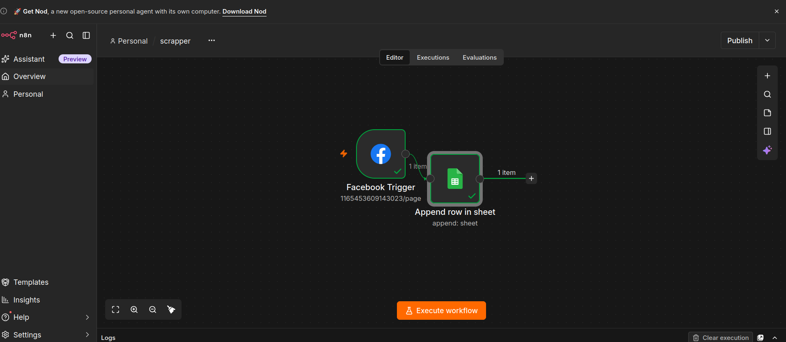
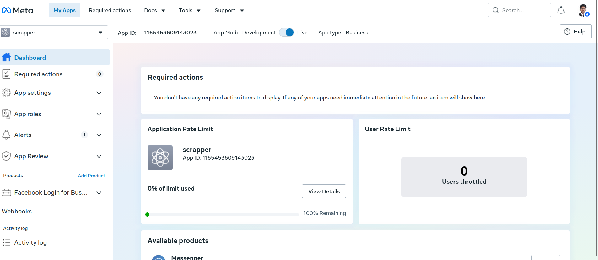
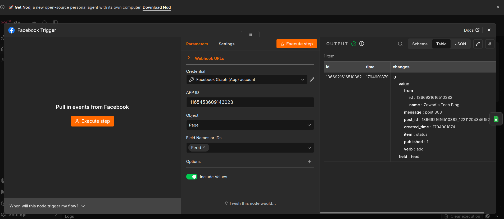
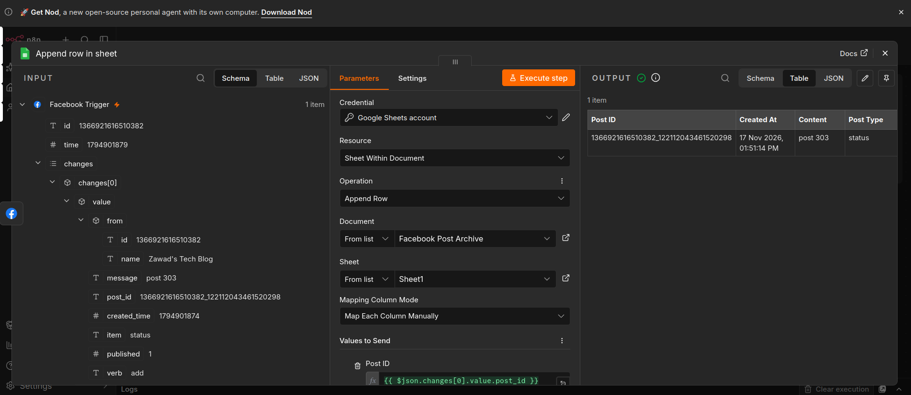
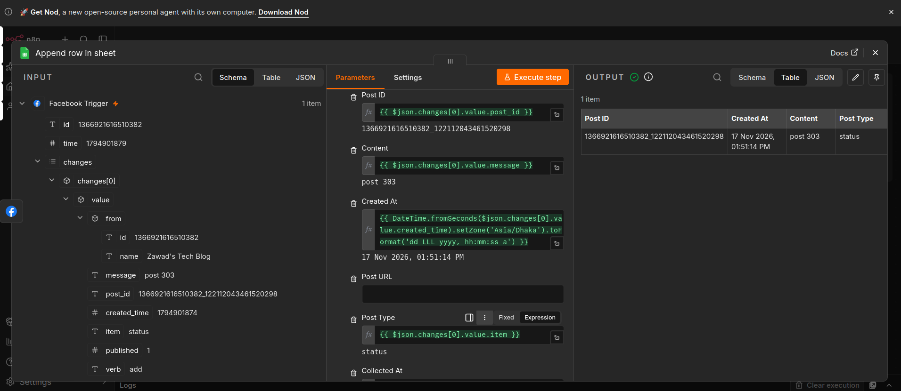
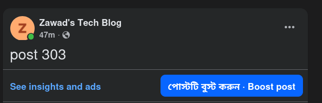
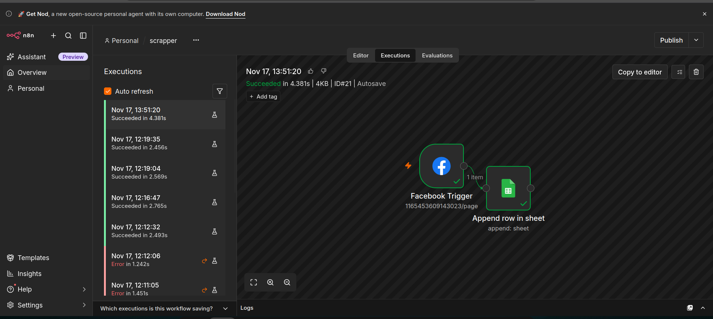

# Workflow Automation Report

**Task:** Facebook Page Post Data Collection to Google Sheets
**Internship at:** CSE TECH, Daffodil International University
**Supervisor:** Md Shoaib Khan
**Submitted by:** Zahin Zawad, ID: 232-15-886
**Date:** 17 November 2026

---

## 1. Task

My supervisor asked me to build an automation system connected to a Facebook Page. Whenever the page publishes a post, the system collects the post data and saves it in a Google Sheet.

The Google Sheet has these columns:

| Column | Meaning |
|---|---|
| Post ID | Unique ID of the post |
| Content | Text of the post |
| Created At | When the post was created |
| Post Type | Type of the post |
| Collected At | When the data was collected |

## 2. Tools Used

- **n8n** – to build the automation workflow
- **Meta for Developers** – to create the app (App ID and App Secret)
- **Facebook Graph API** – to get the access token and post data
- **Google Sheets** – to store the data
- **Google OAuth** – to connect n8n with Google Sheets

## 3. How the Workflow Works

```
Facebook Page (new post) → Facebook Trigger (n8n) → Google Sheets node (n8n) → New row in Google Sheet
```

**Screenshot: Full workflow in n8n**

## 4. Steps I Followed

### Step 1: Facebook app setup
I created an app in Meta for Developers and got the App Secret. I also took an access token from the Facebook Graph API.

**Screenshot: Meta app dashboard (hide the App Secret and token)**



### Step 2: Facebook Trigger node
I added a Facebook Trigger node in n8n and connected it using the App Secret and token. When I tested it, the trigger responded and returned the post data.

**Screenshot: Facebook Trigger node and its output**



### Step 3: Google Sheets node
I added a Google Sheets node after the trigger and connected it to my Google account using OAuth. Then I selected the spreadsheet and set it to add a new row for each post.

**Screenshot: Google Sheets node settings**



### Step 4: Column mapping
I mapped each sheet column to the matching field in the Facebook API response.

| Sheet Column | Taken From |
|---|---|
| Post ID | Post ID field of the Facebook response |
| Content | Post message field of the Facebook response |
| Created At | Post creation time of the Facebook response |
| Post Type | Post type field of the Facebook response |
| Collected At | Current date and time when the workflow runs |

**Screenshot: Column mapping**



## 5. Result

I made a new post from the Facebook Page. The workflow ran automatically and the post data was added to the Google Sheet with all five columns filled correctly. The automation works as required.

**Screenshot: New post on the Facebook Page**



**Screenshot: Successful workflow run in n8n**


**Screenshot: Google Sheet with the collected data**



## 6. Conclusion

I built a working automation using n8n that collects every new Facebook Page post and saves it into a Google Sheet without any manual work. This task helped me learn workflow automation, API connection and data mapping.

I thank my supervisor, Md Shoaib Khan, for his guidance.
